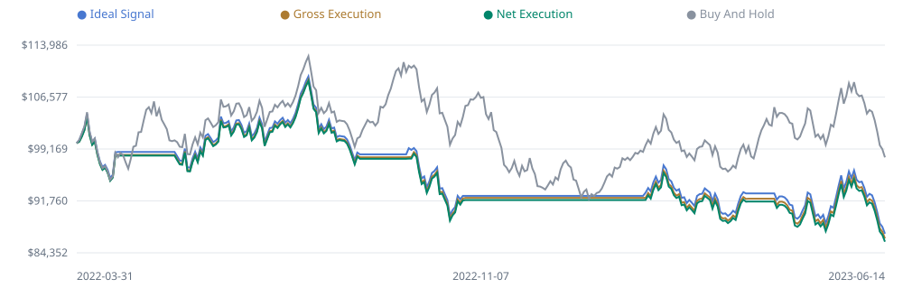

# Trading Research & Execution Engine

A reproducible workflow for testing a historical signal and measuring what changes when orders must actually be simulated: delayed execution, integer shares, limited liquidity, cash constraints, and trading costs.

Python coordinates research, portfolio accounting, and reporting. An interchangeable C++17 kernel prices and sizes fills. A Python reference implementation makes the native behavior independently testable.

**Run the complete demo with Python 3.10+ and no third-party Python packages:**

```bash
python run.py demo --output outputs/demo
```

Open `outputs/demo/report.html` in a browser. The report works offline; its tables and charts are also exported as CSV, JSON, and SVG.



> The bundled example is synthetic. It demonstrates software behavior, not a profitable strategy or verified market performance. Supply your own historical OHLCV CSV to conduct market research. The default example loses money; its parameters have not been tuned to make the screenshot attractive.

## What is implemented

- Strict, chronological OHLCV ingestion with explicit failure on malformed data.
- A long/flat moving-average signal, computed only from completed closes.
- Next-open execution, integer shares, cash checks, volume-based partial fills, and remainder expiry.
- Commission, half-spread, fixed slippage, and participation-dependent impact.
- Separate idealized signal, zero-cost execution, net execution, and buy-and-hold comparisons.
- Chronological training/holdout evaluation and optional training-only parameter selection.
- Fixed-order cost sensitivity, complete order/fill/event ledgers, and input hashes.
- A native fill kernel with ABI checks and randomized Python/C++ parity tests.
- Cross-platform GitHub Actions configuration for Python 3.10 and 3.12.

This is a **single-instrument, daily-bar research simulator**. It does not route live orders, process options, model order-book queues, or claim exchange-level execution fidelity.

## Quick start

Download or clone the repository, open a terminal in its root, then:

```bash
# Fully offline Python path; no pip install required.
python run.py demo --output outputs/demo

# Run the complete test suite.
python -m unittest discover -s tests -v

# Compile the C++ kernel, then enable it explicitly.
python scripts/build_native.py
python run.py demo --backend cpp --native-lib build/execution.so --output outputs/demo-cpp
```

On macOS, use `build/execution.dylib`; on Windows, use `build/execution.dll`. The build script prints the exact path. Use `python3` instead of `python` if that is your system's Python command. Windows can use `py`.

The compiler is optional. If unavailable, the Python implementation runs the same simulation. GCC, Clang, or a configured MSVC Developer Command Prompt can build the native library. No performance advantage is assumed: for small daily datasets, Python-to-C++ call overhead can dominate.

Optional package installation:

```bash
python -m pip install .
tradeengine demo --output outputs/installed-demo
```

Every run requires a **new output directory**, preventing accidental replacement of an earlier experiment.

## Use historical data

```bash
python run.py run --data /path/to/daily.csv --config examples/config.json --output outputs/historical
```

CSV columns must be exactly:

```csv
date,open,high,low,close,volume
2024-01-02,100.00,102.00,99.00,101.00,50000
2024-01-03,101.20,103.00,100.50,102.40,61000
2024-01-04,102.00,102.60,100.10,100.80,47000
```

Those three rows illustrate the schema, not a sufficient research dataset. With the default configuration, supply at least 138 bars; longer samples are preferable. Input must represent one instrument on a consistent price basis. The engine does not download data, repair splits, reinvest dividends, infer exchange calendars, or validate a vendor's licensing. See [the data contract](docs/data.md).

## Read the results

| Result | What it isolates |
| --- | --- |
| Ideal signal | Fractional-share next-open execution, no costs, no volume limit |
| Gross execution | Net-run target orders replayed with integer shares and liquidity/cash constraints, but zero costs |
| Net execution | Actual simulated orders with all configured costs |
| Buy-and-hold | Fractional shares bought at the first eligible open, 100% allocation, no costs |

Gross and net use the **same target schedule**. If costs change affordability, filled quantities can still differ. The report separates direct costs from the remaining fill-path difference; it does not incorrectly attribute the entire performance gap to fees.

The signal targets 95% exposure by default, whereas buy-and-hold targets 100%. Both start flat. Any remaining position is marked at the final close; no fictional final liquidation is inserted.

[Review the committed example summary](examples/review/summary.json), [inspect example fills](examples/review/net_fills.csv), or download [the complete offline example report](examples/review/report.html). GitHub displays HTML source; open the downloaded HTML file locally to see the report.

## Reproduce or select parameters

```bash
# Defaults: 20/60 moving averages, 65% training / 35% holdout.
python run.py demo --seed 17 --bars 900 --output outputs/reproduced

# Optional grid: 10/40, 20/60, 40/120; select by TRAINING net Sharpe.
python run.py demo --select --output outputs/selected

# Replay the committed fixture exactly.
python run.py run --data examples/synthetic.csv --synthetic --output outputs/fixture
```

Selection uses a common training start and never scores candidates on holdout. The holdout starts with fresh cash and no position, using earlier prices only to warm the moving averages. Repeated manual tuning after seeing holdout results still contaminates that holdout. See [methodology](docs/methodology.md).

## Reviewer guide

| Question | Start here |
| --- | --- |
| What runs when? | [`engine.py`](src/tradeengine/engine.py), [architecture](docs/architecture.md) |
| How are costs and partial fills calculated? | [`execution.py`](src/tradeengine/execution.py), [`execution.cpp`](native/execution.cpp) |
| How is leakage tested? | [`test_engine.py`](tests/test_engine.py) |
| How are train/test splits and comparisons built? | [`research.py`](src/tradeengine/research.py) |
| How do I audit an output folder? | [Reproduction and audit guide](docs/reproducibility.md) |
| Which assumptions are simplified? | [Model boundaries](docs/methodology.md#model-boundaries) |
| How do I change the strategy or contribute? | [Development guide](docs/development.md), [CONTRIBUTING.md](CONTRIBUTING.md) |

## Verification

The suite covers hand-calculated fills, cash/position reconciliation, future-data perturbations, next-open timing, partial fills, order replacement, invalid inputs, cost attribution, untouched training selection, and 1,000 deterministic randomized Python/C++ fill comparisons. Native parity tests skip when the library has not been built; build it first for the full suite.

The CI workflow builds and tests on Linux, macOS, and Windows. A workflow definition is not proof of a successful remote run; inspect the repository's Actions tab for its actual status.

See the [local validation record](docs/validation.md) for the environment and checks actually executed.

## License

MIT. See [LICENSE](LICENSE). No third-party market data is distributed in this repository.
